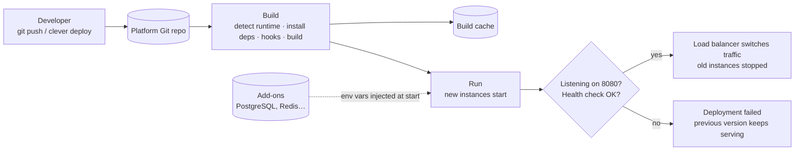
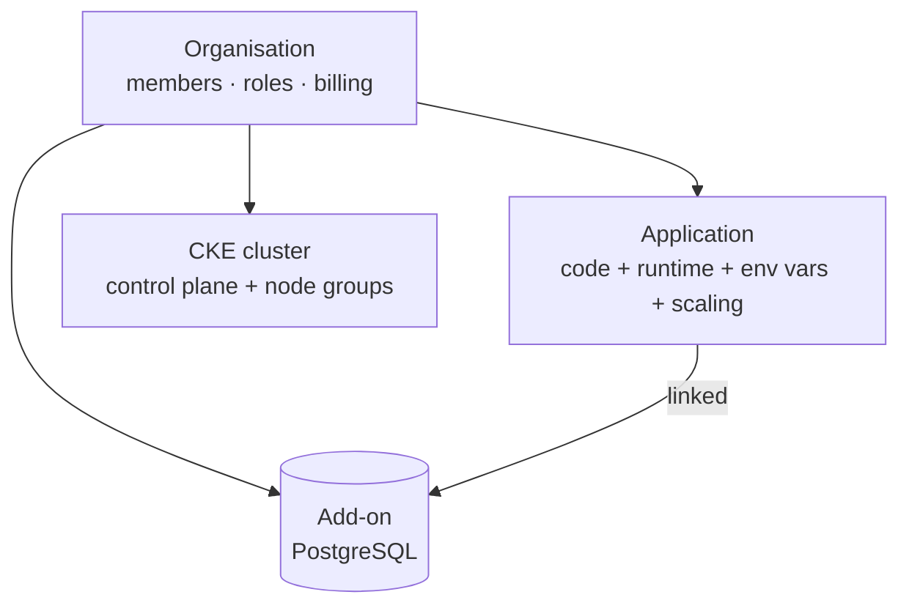

# Using the Clever Cloud platform — Session 1

Hands-on training material: deploy an app, connect a database, use a Kubernetes cluster — from the developer's side.

**Duration:** 2 hours, about 70 % hands-on · **Audience:** support engineers, platform operators and developers new to Clever Cloud

## Contents

| | |
|---|---|
| [`prerequisites.md`](prerequisites.md) | What must be ready before the session: platform access, accounts, tools on your workstation |
| [`lab.md`](lab.md) | The hands-on guide, step by step |
| [`slides/`](slides/) | The session's slides, in English and French (PDF) |
| [`demos/python-app/`](demos/python-app/) | Lab 1–2: a plain Python (Flask) app deployed with the classic Python runtime |
| [`demos/django-todo-uv/`](demos/django-todo-uv/) | Lab 3: a Django app deployed with uv and PostgreSQL (snapshot of [CleverCloud/django-todo-list-example](https://github.com/CleverCloud/django-todo-list-example)) |
| [`demos/k8s/`](demos/k8s/) | Lab 4: manifests for Clever Kubernetes Engine (CKE) |

`lab.md` uses placeholders such as `{{CONSOLE_URL}}`, `{{ORG_NAME}}`, `{{ZONE}}`, `{{APP_DOMAIN}}` and `{{CLUSTER_NAME}}`: your trainer gives you the values for your platform.

## Why a user training for support and operators?

*"We won't be using the platform, we'll support it / run it."* True — but **every ticket you'll receive starts with a developer doing what we do in this session**: creating an app, deploying, linking a database, getting a kubeconfig. If you have never done it yourself:

- you can't tell a platform problem from a usage mistake — and that is the core job of support;
- you can't reproduce what the user describes, nor ask the right qualifying questions;
- you can't explain the fix in the user's words, nor write a useful escalation;
- as an operator, you don't know which of your actions developers will feel.

In this session you are developers. In the next ones, you are the people developers call.

## Learning objectives

At the end of the session, you can:

1. Explain the PaaS model (what the platform does, what the developer owns) and how it differs from managed Kubernetes (CKE).
2. Describe the deployment lifecycle: push → build → run → health check → traffic switch; why instances are disposable.
3. Create, deploy and update a Python application with Clever Tools, and find your way in the Console.
4. List the available add-ons, create a PostgreSQL add-on, link it, and explain how its credentials reach the app.
5. Recognise a modern Python deployment (uv) and what changes compared with the classic one.
6. Get the kubeconfig of a CKE cluster, deploy a workload with `kubectl` in your namespace and reach it.
7. Find deployment logs, application logs and access logs.

## Agenda

1. Why this session, and the mental model: PaaS vs managed Kubernetes, who does what
2. **Lab 1** — Deploy a plain Python app, read the deployment log, ship a new version without downtime
3. **Lab 2** — Add-ons: the catalogue, create a PostgreSQL database, link it to the app
4. **Lab 3** — A modern Python app with uv and PostgreSQL (demo)
5. **Lab 4** — Clever Kubernetes Engine: cluster options, kubeconfig, deploy a workload in your namespace
6. Wrap-up

## Key messages

1. **Know where the line is.** On the PaaS, every developer creates and deploys their own apps: the platform runs the code, the developer owns code, configuration and data. On CKE, developers don't create clusters: a platform team runs one or two shared clusters per organisation (node groups, quotas, access) and developers deploy in their namespace, while Clever Cloud runs the control plane and replaces failed VMs. Where the line is tells you who should fix a problem.
2. **A deployment creates new instances; old ones are discarded.** Nothing on an instance's disk survives — state lives in add-ons.
3. **Configuration = environment variables**: yours, the platform's (`CC_*`), and those injected by linked add-ons. Changing them requires a restart.
4. **Zero downtime comes from blue/green**: new instances start and pass the health check before traffic switches.
5. **The deployment log tells the story** step by step: always read it first.
6. **The runtime adapts to the project**: `requirements.txt` → classic mode (`CC_PYTHON_MODULE`); `uv.lock` + `CC_PYTHON_UV_RUN_COMMAND` → native uv mode. Same platform, different behaviour — check which one applies.

## Who does what

| | Who creates it | Build & run your app | OS, runtime, patches | Load balancing, TLS | Scaling | Data | Kubernetes control plane | Nodes | Workloads (pods) |
|---|---|---|---|---|---|---|---|---|---|
| **PaaS app** | Each developer, per app | Platform | Platform | Platform | Platform (you set bounds) | Add-on (managed) | — | — | — |
| **CKE** | Platform team: 1–2 shared clusters per organisation; developers get a namespace | You (images, manifests) | Control plane: platform · container images: you | L4 LoadBalancer: platform · TLS/ingress: you | You (node groups, optional autoscaler) | You / add-ons via operator | Platform | You size node groups, platform replaces failed VMs | You |

## Deployment lifecycle (PaaS)

## Resources

## Not covered here

Troubleshooting method and break-and-fix scenarios, runtime-specific configuration (Java, PHP, Node.js…), log drains and metrics, storage choices (sessions, caches, concurrency), CKE node groups, persistent storage and networking: these are topics for the following sessions.

## Documentation

- Clever Cloud documentation: <https://www.clever.cloud/developers/doc/>
- Clever Tools CLI reference: <https://www.clever.cloud/developers/doc/cli-reference/>
- Python runtime: <https://www.clever.cloud/developers/doc/deploy/applications/python/> · with uv: <https://www.clever.cloud/developers/doc/deploy/applications/python/uv/>
- Clever Kubernetes Engine: <https://www.clever.cloud/developers/doc/deploy/kubernetes/>
